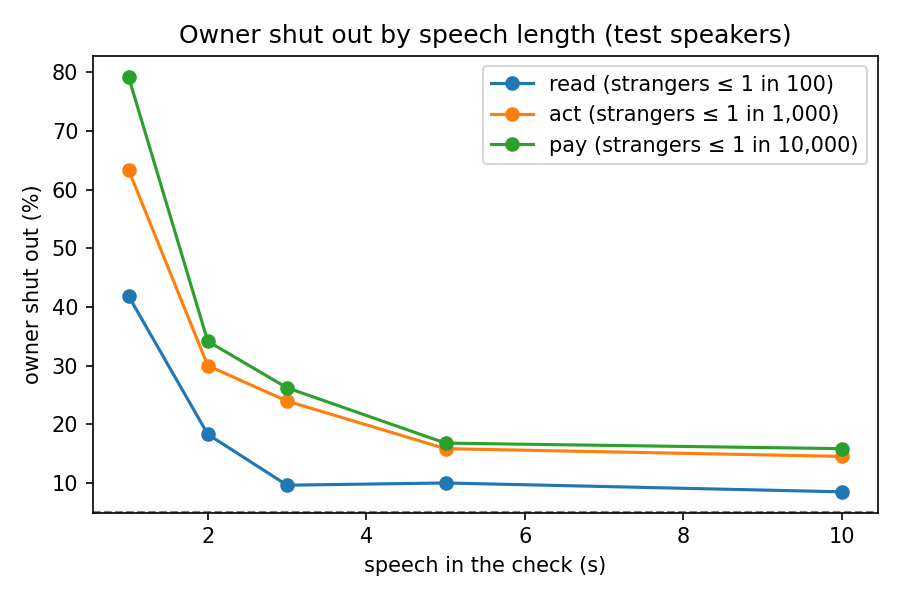

# Report

## Approach

One open speaker model (Resemblyzer), a 30 s setup per person, and a cosine score against the setup. A request passes if its voice score is high enough (voice check) and the motion sensor moves with the speech (motion check). Limits and speech length are chosen on 20 speakers and reported on 20 others (LibriSpeech test-clean).

Why Resemblyzer: open, small (17 MB) and fast on a laptop CPU (0.4 s for a 3 s request), so it could fit on a headset. The model was not trained for very short speech, a model built for it would do better.

## Answer

No speech length meets a 5% owner lockout for any action, even 10 s. So I chose each length where more speech stops helping, and the check never refuses outright: when unsure, it listens longer, then asks for one tap on the phone.

| Action | Strangers let in | Owner shut out | Speech | Result on unseen speakers | Check |
|---|---|---|---|---|---|
| Read a message aloud | 1 in 100 | 5% | **3 s** | owner shut out 9.6%, lookalike in 0.26% | voice, then phone tap |
| Send, book, change | 1 in 1,000 | 5% | **5 s** | owner shut out 15.8%, no lookalike in | voice, then phone tap |
| Pay | 1 in 10,000 | 5% | – | 2,663 lookalike trials prove only "below 1 in 900" | phone tap always |

Past 3 s, more speech barely helps: read is 9.6% at 3 s and 8.5% at 10 s. The lockouts come from a few owners, not from short speech (see below).

**Stranger:** both. A colleague is anyone else of the same sex. An attacker is one of the 5 voices closest to the owner, same sex. The limit must hold for both. Attackers get in about twice as often as colleagues (0.04% vs 0.02% at read, 10 s).

**Recorded voice:** played from a loudspeaker, the owner's voice passes the voice check in at most 0.2% of tries and never passes the motion check too, unless the loudspeaker sound reaches the motion sensor as strongly as the wearer's own voice (then 1 clip in 530).

## Why these limits

- **Read, 1 in 100.** A wrong read leaks one message to someone already holding the headset.
- **Act, 1 in 1,000.** A wrong email or booking can be undone, but others see it.
- **Pay, 1 in 10,000.** Money cannot be undone. FIDO certifies biometrics at this rate.
- **Owner shut out, 5%.** Above that, people stop using the feature.

## How it fails

- **Short speech.** At 1 s the owner is shut out 42% even at the read limit.
- **A few owners cause most lockouts.** At read, 10 s, 5 of 20 owners are over 5%; the other 15 are shut out 0.8%. The worst, 4446, is shut out 84%: the setup chapter sounds unlike the later ones. Fix: check the setup quality, and add confident later speech to it.
- **Strangers who get in are the same sex.** At read, 10 s, one colleague got in (7021 into 7176).
- **The limits are stricter than needed.** Set on 20 dev speakers, they let in far fewer strangers on test than allowed (0.26% vs 1%), and the owner pays for it.
- **Motion check costs the owner 0.8 to 1.9%.** Its threshold is set per person, from the setup.

## Own idea: evidence builds during a wearing

Pool the short requests made while the headset stays on. Three 2 s requests shut the owner out 18.0% at the act limit, worse than one 5 s request (14.5%, voice only). Pooling lets short requests add up, but it does not beat speaking longer.

## What I cut

- **Voice clones.** Testing them needs a cloning tool and my own voice. The motion check does not depend on how good a clone is.
- **Real sensor data.** None is public, so the motion sensor and loudspeaker are simulated.
- **Noise, accents, other microphones.** Clean audiobooks only.
- **More speakers.** test-clean's 40 only; more would mainly help prove the act and pay limits.
- **A spoof detector.** One more signal, never the only one (see the design).

## What I would fix first

1. **Check the setup.** Ask for more speech when the setup does not match the owner's own later speech well (owner 4446).
2. **Real headset audio.** Record with a headset, in noise, with a real motion sensor.
3. **More speakers,** to prove the act and pay limits.

## Demo

A small web app: set up your own voice, then check who is speaking. See [run.md](run.md#demo).

## Limits

- 40 read-aloud speakers, clean audio. Real headsets, noise and accents will be worse.
- Replay and motion sensor are simulated.
- No voice clones tested.
- The pay limit needs about 30,000 attacker trials to prove. This data has 2,663 lookalike trials.

## How I built it

Python, Resemblyzer (GE2E), NumPy, SciPy, Matplotlib, Gradio for the demo. Full numbers: [results/summary.md](../results/summary.md).
